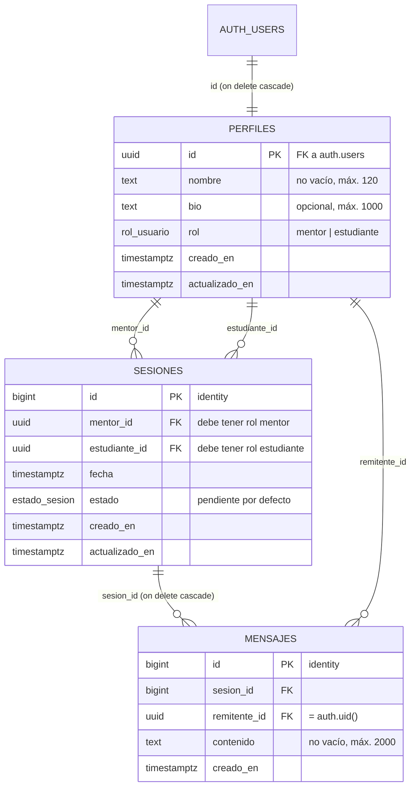

# MentorLink: infraestructura con Supabase e IA

Proyecto Integrador: Implementación de Infraestructura con Supabase e IA.

| Campo | Valor |
|---|---|
| Materia | [Materia] |
| Integrantes | [Integrantes] |
| Fecha de entrega | 29 de octubre de 2026 |
| Repositorio | https://github.com/Josuehmz/mentorlink-supabase |

Este documento reúne los cuatro entregables del enunciado, en orden, más la auditoría:

| Entregable del enunciado | Sección |
|---|---|
| Scripts SQL generados (tablas y políticas RLS completas) | [1. Esquema de datos y políticas RLS](#1-esquema-de-datos-y-políticas-rls) |
| Prompt de IA utilizado (texto exacto) | [2. Prompts de IA utilizados](#2-prompts-de-ia-utilizados) |
| Capturas o log de comandos de la CLI | [3. Supabase CLI: comandos y evidencia](#3-supabase-cli-comandos-y-evidencia) |
| Guía de configuración Auth (3 pasos para Google) | [4. Guía de configuración de Auth](#4-guía-de-configuración-de-auth-emailpassword-y-google) |
| Auditoría IA (cuatro ejes) | [5. Auditoría IA](#5-auditoría-ia-los-cuatro-ejes) |

Qué se ejecutó y qué no: la CLI de Supabase 2.122.0 se ejecutó en local (`init`, `migration new`,
`start`, `db reset`, `migration list --local`, `test db`, `stop`); `supabase test db` pasó las 41
pruebas pgTAP y la salida de cada comando está en `docs/evidencia/cli/`. Los pasos de la nube
(`login`, `link`, `db push`) no se ejecutaron porque no existe un proyecto en la nube;
`<project-ref>` y las credenciales de Google son marcadores.

## 1. Esquema de datos y políticas RLS

MentorLink guarda tres cosas: quién es cada usuario (`perfiles`), qué mentorías se acordaron
(`sesiones`) y qué se dijeron (`mensajes`). El navegador habla directo con la base de datos a
través de la API de Supabase usando la clave pública, así que **la autorización vive en la base de
datos**: privilegios por tabla y columna, políticas RLS por fila y triggers para las reglas de
negocio.

- Fuente de verdad: [`supabase/migrations/20261027004403_inicializar_esquema.sql`](supabase/migrations/20261027004403_inicializar_esquema.sql) (331 líneas), creado con `supabase migration new inicializar_esquema`.
- La sección [1.8](#18-script-sql-completo) es una copia exacta de ese archivo, sincronizada por
  [`herramientas/armar_entrega.py`](herramientas/armar_entrega.py) (`--verificar` falla si difieren).
- Origen: generado con un asistente de IA a partir del [prompt maestro](#2-prompts-de-ia-utilizados), ejecutado,
  probado y corregido con un prompt de refinamiento.
- Verificado de verdad con la CLI de Supabase: `supabase db reset` aplica la migración y el seed, y
  `supabase test db` pasa las 41 pruebas pgTAP de
  [`supabase/tests/mentorlink_rls_test.sql`](supabase/tests/mentorlink_rls_test.sql)
  ([salida](docs/evidencia/cli/08-test-db.txt)). Además, las 25 comprobaciones de
  [`supabase/pruebas/rls.sql`](supabase/pruebas/rls.sql) pasan en PostgreSQL 17
  ([salida completa](docs/evidencia/salida-pruebas-rls.txt)).

### 1.1 Modelo de datos

Relaciones:

- `perfiles.id` → `auth.users.id` (1:1, `on delete cascade`): cada cuenta de Supabase Auth tiene un perfil.
- `sesiones.mentor_id` → `perfiles.id` y `sesiones.estudiante_id` → `perfiles.id` (1:N cada una):
  una sesión une a un mentor con un estudiante.
- `mensajes.sesion_id` → `sesiones.id` (1:N, `on delete cascade`): los mensajes pertenecen a una sesión.
- `mensajes.remitente_id` → `perfiles.id` (1:N): quién escribió el mensaje.

Diagrama entidad-relación (Mermaid, se dibuja en GitHub):



### 1.2 Tipos y restricciones

| Decisión | Por qué |
|---|---|
| `perfiles.id uuid primary key references auth.users(id) on delete cascade` | Relación 1:1 con la cuenta de Supabase Auth; borrar la cuenta borra el perfil (patrón oficial). |
| `rol` y `estado` como `enum` (`rol_usuario`, `estado_sesion`) | Valores cerrados validados por el tipo, no por texto libre. |
| `sesiones.id` y `mensajes.id` como `bigint generated always as identity` | Índices compactos y orden natural; la enumeración de ids no sirve de nada porque RLS filtra cada fila (prueba 21). |
| `check (mentor_id <> estudiante_id)` | Nadie se da una mentoría a sí mismo. |
| Textos con `check` de longitud y `btrim` | `nombre` y `contenido` no pueden ser vacíos ni solo espacios (prueba 11). |
| Fechas `timestamptz` | Mentores y estudiantes pueden estar en zonas horarias distintas. |
| FK a `perfiles` con `on delete cascade` | Si se borra una cuenta no quedan sesiones ni mensajes apuntando a nadie. Riesgo aceptado en [1.7](#17-riesgos-aceptados). |
| Índices en `mentor_id`, `estudiante_id`, `(sesion_id, creado_en)` y `remitente_id` | Son las columnas que usan las políticas; sin índice, cada consulta con RLS recorre la tabla. |
| `mensajes` sin `actualizado_en` | Los mensajes no se editan; la columna era ruido (quitada en el refinamiento). |

### 1.3 Privilegios (antes de RLS)

Una tabla nueva de `public` en Supabase nace con todos los privilegios concedidos a `anon` y
`authenticated`, y agregar políticas no los quita. Por eso la migración revoca todo y concede solo
lo que usa cada política:

| Tabla | `authenticated` | `anon` |
|---|---|---|
| `perfiles` | `select`; `update (nombre, bio)` | nada |
| `sesiones` | `select`; `insert (mentor_id, estudiante_id, fecha, estado)`; `update (estado, fecha)` | nada |
| `mensajes` | `select`; `insert (sesion_id, remitente_id, contenido)` | nada |

El privilegio por columna impide que un usuario cambie su propio `rol` (prueba 12) o mueva una
sesión a otros participantes. Sin `delete` en ninguna tabla: las sesiones se cancelan y los
mensajes son un historial inmutable (prueba 14). Las funciones de trigger tampoco se pueden
llamar desde la API (`revoke all on function ... from public, anon, authenticated`).

### 1.4 Políticas RLS

RLS está activado en las tres tablas. Todas las políticas son `to authenticated` y usan
`(select auth.uid())` en lugar de `auth.uid()`, para que Postgres evalúe la función una vez por
consulta y no una vez por fila (recomendación de rendimiento de Supabase).

| Política | Tabla | Operación | Regla |
|---|---|---|---|
| perfiles: ver propio, mentores y contrapartes de sesión | perfiles | SELECT | `id = auth.uid()` o `rol = 'mentor'` o existe una sesión donde el usuario y ese perfil son mentor y estudiante entre sí |
| perfiles: editar solo el propio | perfiles | UPDATE | `id = auth.uid()` en USING y WITH CHECK; el privilegio de columna limita a `nombre` y `bio` |
| sesiones: ver solo como participante | sesiones | SELECT | `auth.uid()` es `mentor_id` o `estudiante_id` |
| sesiones: solicitar como estudiante, pendiente y a futuro | sesiones | INSERT | `estudiante_id = auth.uid()`, `estado = 'pendiente'`, `fecha > now()`; el trigger exige roles correctos |
| sesiones: actualizar estado y fecha solo participantes | sesiones | UPDATE | participante en USING y WITH CHECK; el trigger `sesiones_validar_transicion` decide quién hace cada transición |
| mensajes: ver solo si participas en la sesión | mensajes | SELECT | existe la sesión `sesion_id` con `auth.uid()` como mentor o estudiante |
| mensajes: enviar como participante y remitente propio | mensajes | INSERT | `remitente_id = auth.uid()`, participa en la sesión y la sesión está `pendiente` o `confirmada` |

**Por qué los perfiles de mentores son visibles para cualquier usuario autenticado:** MentorLink es
un directorio donde el estudiante busca mentor; si solo viera su propio perfil no podría elegir a
nadie. Los perfiles de estudiantes no son públicos: solo los ve el mentor con quien comparten una
sesión (pruebas 03, 16 y 19).

### 1.5 Reglas en triggers

| Función (trigger) | Cuándo | Qué hace |
|---|---|---|
| `handle_new_user` (`on_auth_user_created`) | `after insert on auth.users` | Crea el perfil. Nombre: `nombre` de los metadatos, si no `full_name` (Google), si no la parte local del email. Rol: siempre `estudiante`; el `rol` que mande el cliente en los metadatos se ignora (prueba 01, sonda del rol). Promover a mentor lo hace `service_role`. `security definer` y `set search_path = ''`, como el patrón oficial. |
| `validar_roles_sesion` (`sesiones_validar_roles`) | `before insert or update of mentor_id, estudiante_id` | `mentor_id` debe tener rol mentor y `estudiante_id` rol estudiante (pruebas 08 y 25). |
| `validar_transicion_sesion` (`sesiones_validar_transicion`) | `before update of estado, fecha` | Máquina de estados: confirmar y completar solo el mentor; cancelar cualquiera de los dos; `completada` y `cancelada` son finales; la fecha solo cambia a futuro (pruebas 15, 17, 22 y 23). |
| `fijar_actualizado_en` | `before update` en perfiles y sesiones | Mantiene `actualizado_en`. |

**Por qué el rol del mentor se valida en un trigger y no en la política:** `service_role` (backend,
SQL del dashboard) se salta RLS, pero no los triggers. Así la regla «una sesión une a un mentor con
un estudiante» se cumple venga de donde venga el dato (prueba 25). Además la política quedaría
con una subconsulta extra a `perfiles` en cada inserción.

Máquina de estados de `sesiones`:

| Desde | Hacia | Quién |
|---|---|---|
| `pendiente` | `confirmada` | solo el mentor |
| `pendiente` | `cancelada` | mentor o estudiante |
| `confirmada` | `completada` | solo el mentor |
| `confirmada` | `cancelada` | mentor o estudiante |
| `completada`, `cancelada` | (ninguno) | estados finales |

### 1.6 Verificación

**Quién puede ser mentor.** `raw_user_meta_data` lo escribe el cliente en `signUp`
(`options.data`), así que no sirve para decidir permisos. Todo registro nace `estudiante` y la
promoción es una acción administrativa:

```sql
-- con service_role (backend) o desde el SQL Editor del Dashboard
update public.perfiles set rol = 'mentor' where id = '<uuid-del-usuario>';
```

Desde la API nadie se promueve a sí mismo: `authenticated` no tiene `UPDATE` sobre la columna
`rol` (prueba 12). La sonda que lo comprueba (un registro que pide `{"rol": "mentor"}` y nace
`estudiante`) está en la prueba 01 de `rls.sql` y en la pgTAP «sonda del rol».

#### Pruebas pgTAP con `supabase test db`

[`supabase/tests/mentorlink_rls_test.sql`](supabase/tests/mentorlink_rls_test.sql) tiene 41
pruebas pgTAP: estructura (RLS activo, grants, `(select auth.uid())`), `handle_new_user`, la sonda
del rol, la promoción por `service_role`, `anon`, estudiante, mentor, intruso, transiciones de
estado e integridad para roles privilegiados. Corrió con la CLI real contra Supabase local:
[`evidencia/cli/08-test-db.txt`](docs/evidencia/cli/08-test-db.txt).

#### Prueba con avisos (`rls.sql`)

[`supabase/pruebas/rls.sql`](supabase/pruebas/rls.sql) simula cuatro usuarios con
`set local role authenticated` y `set local request.jwt.claims` (lo mismo que hace la API de
Supabase con cada JWT) y termina en `rollback`. Pasó 25 de 25 contra el Supabase local de la CLI
([salida](docs/evidencia/cli/12-rls-sql-en-supabase-local.txt)) y en PostgreSQL 17.9 (Docker) con
[`pruebas-locales/ejecutar-pruebas.sh`](pruebas-locales/ejecutar-pruebas.sh), sin la CLI
([salida](docs/evidencia/salida-pruebas-rls.txt)).

| # | Qué se comprueba | Resultado esperado |
|---|---|---|
| 01 | `handle_new_user` con nombre, `full_name` de Google, `rol: "mentor"` y `rol: "admin"`; luego `service_role` promueve a dos mentores | todos nacen `estudiante`; la promoción pasa |
| 02 | `anon` lee perfiles o mensajes | `permission denied` |
| 03 | Estudiante lista perfiles | se ve a sí mismo y a los mentores, no a otros estudiantes |
| 04-07 | Solicitar sesión propia / a nombre de otro / en el pasado / ya confirmada | solo la primera pasa |
| 08 | Sesión con un estudiante como mentor | `check_violation` del trigger |
| 09-11 | Mensaje propio / suplantando remitente / vacío | solo el primero pasa |
| 12-14 | Cambiar el propio rol, editar perfil ajeno, editar o borrar mensajes, borrar sesiones | todo rechazado |
| 15 | El estudiante confirma su propia sesión | rechazado por el trigger |
| 16-18 | La mentora ve su sesión y a su estudiante, confirma y responde | pasa |
| 19-21 | Estudiante ajena lee, modifica o escribe en la sesión (aun conociendo el id) | 0 filas o rechazado |
| 22-24 | Cancelar, reabrir una cancelada, escribir en una cancelada | solo cancelar pasa |
| 25 | `service_role` crea una sesión entre dos estudiantes | rechazado por el trigger |

La primera versión que dio la IA falló en la prueba 15
([salida de esa corrida](docs/evidencia/prueba-1-respuesta-sin-refinar.txt)); eso motivó el
refinamiento descrito en [2. Prompts de IA](#2-prompts-de-ia-utilizados).

### 1.7 Riesgos aceptados

- **Cascadas:** borrar una cuenta borra sus sesiones y los mensajes de ambos participantes. Si el
  historial debe sobrevivir, se cambia a borrado lógico.
- **Reprogramar sin reconfirmar:** cualquiera de los dos puede mover la fecha de una sesión
  confirmada y sigue confirmada.
- **Sesiones vencidas:** nada pasa a `completada` sola; haría falta un job (por ejemplo `pg_cron`).
- **Directorio de mentores:** toda columna nueva de `perfiles` queda visible para los mentores;
  una columna sensible iría en otra tabla.

### 1.8 Script SQL completo

````sql
-- supabase/migrations/20261027004403_inicializar_esquema.sql
-- MentorLink: esquema inicial (perfiles, sesiones, mensajes) con RLS y privilegios explícitos.

-- =====================================================================
-- 1. TIPOS
-- =====================================================================
create type public.rol_usuario as enum ('mentor', 'estudiante');
create type public.estado_sesion as enum ('pendiente', 'confirmada', 'completada', 'cancelada');

-- =====================================================================
-- 2. TABLAS
-- =====================================================================

-- perfiles.id: uuid porque es 1:1 con auth.users; on delete cascade: si se borra la cuenta, se borra el perfil.
create table public.perfiles (
  id             uuid primary key references auth.users (id) on delete cascade,
  nombre         text not null
                 check (char_length(btrim(nombre)) > 0 and char_length(nombre) <= 120),
  bio            text
                 check (bio is null or char_length(bio) <= 1000),
  rol            public.rol_usuario not null default 'estudiante',
  creado_en      timestamptz not null default now(),
  actualizado_en timestamptz not null default now()
);

create table public.sesiones (
  -- id: bigint identity; índices compactos y la enumeración la bloquea RLS, no la opacidad del id.
  id             bigint generated always as identity primary key,
  -- mentor_id: on delete cascade; borrar la cuenta del mentor elimina sus sesiones (no hay perfil al que apuntar).
  mentor_id      uuid not null references public.perfiles (id) on delete cascade,
  -- estudiante_id: on delete cascade; mismo criterio que mentor_id (las columnas son not null).
  estudiante_id  uuid not null references public.perfiles (id) on delete cascade,
  fecha          timestamptz not null,
  estado         public.estado_sesion not null default 'pendiente',
  creado_en      timestamptz not null default now(),
  actualizado_en timestamptz not null default now(),
  constraint sesiones_participantes_distintos check (mentor_id <> estudiante_id)
);

-- mensajes: sin actualizado_en; el historial es inmutable y no hay UPDATE.
create table public.mensajes (
  -- id: bigint identity; volumen alto, orden natural de inserción y RLS protege el acceso.
  id             bigint generated always as identity primary key,
  -- sesion_id: on delete cascade; un mensaje no tiene sentido sin su sesión.
  sesion_id      bigint not null references public.sesiones (id) on delete cascade,
  -- remitente_id: on delete cascade; el remitente es not null y su cuenta borrada arrastra sus mensajes.
  remitente_id   uuid not null references public.perfiles (id) on delete cascade,
  contenido      text not null
                 check (char_length(btrim(contenido)) > 0 and char_length(contenido) <= 2000),
  creado_en      timestamptz not null default now()
);

-- =====================================================================
-- 3. ÍNDICES (columnas FK usadas en políticas y joins)
-- =====================================================================
create index sesiones_mentor_id_idx      on public.sesiones (mentor_id);
create index sesiones_estudiante_id_idx  on public.sesiones (estudiante_id);
create index mensajes_sesion_id_idx      on public.mensajes (sesion_id, creado_en);
create index mensajes_remitente_id_idx   on public.mensajes (remitente_id);

-- =====================================================================
-- 4. FUNCIONES Y TRIGGERS
-- =====================================================================

-- 4.1 Mantener actualizado_en (solo perfiles y sesiones; mensajes no se editan)
create or replace function public.fijar_actualizado_en()
returns trigger
language plpgsql
set search_path = ''
as $$
begin
  new.actualizado_en := pg_catalog.now();
  return new;
end;
$$;

create trigger perfiles_fijar_actualizado_en
  before update on public.perfiles
  for each row execute function public.fijar_actualizado_en();

create trigger sesiones_fijar_actualizado_en
  before update on public.sesiones
  for each row execute function public.fijar_actualizado_en();

-- 4.2 Crear el perfil al registrarse (patrón oficial de Supabase)
--   El rol NO se toma de raw_user_meta_data: ese campo lo escribe el cliente en signUp
--   (options.data), así que cualquiera podría registrarse como mentor. Todo registro nace
--   'estudiante'; promover a mentor es una acción administrativa con service_role
--   (backend o SQL del Dashboard), porque authenticated no tiene UPDATE sobre perfiles.rol.
create or replace function public.handle_new_user()
returns trigger
language plpgsql
security definer
set search_path = ''
as $$
declare
  v_meta   jsonb := coalesce(new.raw_user_meta_data, '{}'::jsonb);
  v_nombre text;
begin
  v_nombre := coalesce(
    nullif(pg_catalog.btrim(v_meta ->> 'nombre'), ''),
    nullif(pg_catalog.btrim(v_meta ->> 'full_name'), ''),          -- Google OAuth
    nullif(pg_catalog.btrim(pg_catalog.split_part(new.email, '@', 1)), ''),
    'usuario'                                                        -- sin email (p. ej. teléfono)
  );
  v_nombre := pg_catalog.left(v_nombre, 120);

  insert into public.perfiles (id, nombre, rol)
  values (new.id, v_nombre, 'estudiante'::public.rol_usuario);

  return new;
end;
$$;

create trigger on_auth_user_created
  after insert on auth.users
  for each row execute function public.handle_new_user();

-- 4.3 Validar roles de los participantes de una sesión (aplica también a service_role)
create or replace function public.validar_roles_sesion()
returns trigger
language plpgsql
security definer
set search_path = ''
as $$
begin
  if not exists (
    select 1 from public.perfiles p
    where p.id = new.mentor_id and p.rol = 'mentor'::public.rol_usuario
  ) then
    raise exception 'mentor_id (%) no corresponde a un perfil con rol mentor', new.mentor_id
      using errcode = 'check_violation';
  end if;

  if not exists (
    select 1 from public.perfiles p
    where p.id = new.estudiante_id and p.rol = 'estudiante'::public.rol_usuario
  ) then
    raise exception 'estudiante_id (%) no corresponde a un perfil con rol estudiante', new.estudiante_id
      using errcode = 'check_violation';
  end if;

  return new;
end;
$$;

create trigger sesiones_validar_roles
  before insert or update of mentor_id, estudiante_id on public.sesiones
  for each row execute function public.validar_roles_sesion();

-- 4.4 Máquina de estados de sesiones (aplica también a service_role).
--   pendiente  -> confirmada : solo el mentor
--   pendiente  -> cancelada  : cualquiera de los dos participantes
--   confirmada -> completada : solo el mentor
--   confirmada -> cancelada  : cualquiera de los dos
--   completada y cancelada   : finales, no cambian
--   fecha: solo cambia en pendiente o confirmada, y siempre a futuro.
--   Con auth.uid() null (service_role, SQL del dashboard) se validan las transiciones, no el actor.
create or replace function public.validar_transicion_sesion()
returns trigger
language plpgsql
security definer
set search_path = ''
as $$
declare
  v_uid uuid := auth.uid();
begin
  -- Estados finales: ni estado ni fecha pueden cambiar.
  if old.estado in ('completada'::public.estado_sesion, 'cancelada'::public.estado_sesion)
     and (new.estado is distinct from old.estado or new.fecha is distinct from old.fecha) then
    raise exception 'la sesión % está en estado final (%) y no puede cambiar', old.id, old.estado
      using errcode = 'check_violation';
  end if;

  -- Transiciones de estado.
  if new.estado is distinct from old.estado then
    if old.estado = 'pendiente'::public.estado_sesion
       and new.estado = 'confirmada'::public.estado_sesion then
      if v_uid is not null and v_uid <> old.mentor_id then
        raise exception 'solo el mentor puede confirmar la sesión %', old.id
          using errcode = 'check_violation';
      end if;

    elsif old.estado = 'confirmada'::public.estado_sesion
          and new.estado = 'completada'::public.estado_sesion then
      if v_uid is not null and v_uid <> old.mentor_id then
        raise exception 'solo el mentor puede completar la sesión %', old.id
          using errcode = 'check_violation';
      end if;

    elsif old.estado in ('pendiente'::public.estado_sesion, 'confirmada'::public.estado_sesion)
          and new.estado = 'cancelada'::public.estado_sesion then
      -- Cualquiera de los dos participantes; la política de UPDATE ya exige participar.
      null;

    else
      raise exception 'transición de estado no permitida en la sesión %: % -> %',
        old.id, old.estado, new.estado
        using errcode = 'check_violation';
    end if;
  end if;

  -- Cambio de fecha: solo en pendiente o confirmada y a futuro.
  if new.fecha is distinct from old.fecha then
    if old.estado not in ('pendiente'::public.estado_sesion, 'confirmada'::public.estado_sesion) then
      raise exception 'la fecha de la sesión % solo cambia en pendiente o confirmada', old.id
        using errcode = 'check_violation';
    end if;
    if new.fecha <= pg_catalog.now() then
      raise exception 'la nueva fecha de la sesión % debe ser futura', old.id
        using errcode = 'check_violation';
    end if;
  end if;

  return new;
end;
$$;

create trigger sesiones_validar_transicion
  before update of estado, fecha on public.sesiones
  for each row execute function public.validar_transicion_sesion();

-- Las funciones de trigger no deben poder invocarse desde la API.
revoke all on function public.fijar_actualizado_en()       from public, anon, authenticated;
revoke all on function public.handle_new_user()            from public, anon, authenticated;
revoke all on function public.validar_roles_sesion()       from public, anon, authenticated;
revoke all on function public.validar_transicion_sesion()  from public, anon, authenticated;

-- =====================================================================
-- 5. PRIVILEGIOS
-- =====================================================================
revoke all on table public.perfiles from public, anon, authenticated;
revoke all on table public.sesiones from public, anon, authenticated;
revoke all on table public.mensajes from public, anon, authenticated;

-- perfiles: lectura y edición de nombre y bio (rol no editable).
grant select                 on table public.perfiles to authenticated;
grant update (nombre, bio)   on table public.perfiles to authenticated;

-- sesiones: lectura, alta (sin id ni auditoría) y cambio de estado y fecha.
grant select                                            on table public.sesiones to authenticated;
grant insert (mentor_id, estudiante_id, fecha, estado)  on table public.sesiones to authenticated;
grant update (estado, fecha)                            on table public.sesiones to authenticated;

-- mensajes: lectura y alta; sin update ni delete.
grant select                                      on table public.mensajes to authenticated;
grant insert (sesion_id, remitente_id, contenido) on table public.mensajes to authenticated;

-- =====================================================================
-- 6. RLS Y POLÍTICAS
-- =====================================================================
alter table public.perfiles enable row level security;
alter table public.sesiones enable row level security;
alter table public.mensajes enable row level security;

-- ---------- perfiles ----------
create policy "perfiles: ver propio, mentores y contrapartes de sesión"
  on public.perfiles
  for select
  to authenticated
  using (
    id = (select auth.uid())
    or rol = 'mentor'::public.rol_usuario
    or exists (
      select 1
      from public.sesiones s
      where (s.mentor_id = (select auth.uid()) and s.estudiante_id = perfiles.id)
         or (s.estudiante_id = (select auth.uid()) and s.mentor_id = perfiles.id)
    )
  );

create policy "perfiles: editar solo el propio"
  on public.perfiles
  for update
  to authenticated
  using (id = (select auth.uid()))
  with check (id = (select auth.uid()));

-- ---------- sesiones ----------
create policy "sesiones: ver solo como participante"
  on public.sesiones
  for select
  to authenticated
  using ((select auth.uid()) in (mentor_id, estudiante_id));

create policy "sesiones: solicitar como estudiante, pendiente y a futuro"
  on public.sesiones
  for insert
  to authenticated
  with check (
    estudiante_id = (select auth.uid())
    and estado = 'pendiente'::public.estado_sesion
    and fecha > now()
  );

-- Quién puede hacer cada transición lo decide el trigger sesiones_validar_transicion.
create policy "sesiones: actualizar estado y fecha solo participantes"
  on public.sesiones
  for update
  to authenticated
  using ((select auth.uid()) in (mentor_id, estudiante_id))
  with check ((select auth.uid()) in (mentor_id, estudiante_id));

-- ---------- mensajes ----------
create policy "mensajes: ver solo si participas en la sesión"
  on public.mensajes
  for select
  to authenticated
  using (
    exists (
      select 1
      from public.sesiones s
      where s.id = mensajes.sesion_id
        and (select auth.uid()) in (s.mentor_id, s.estudiante_id)
    )
  );

create policy "mensajes: enviar como participante y remitente propio"
  on public.mensajes
  for insert
  to authenticated
  with check (
    remitente_id = (select auth.uid())
    and exists (
      select 1
      from public.sesiones s
      where s.id = mensajes.sesion_id
        and (select auth.uid()) in (s.mentor_id, s.estudiante_id)
        and s.estado in ('pendiente'::public.estado_sesion, 'confirmada'::public.estado_sesion)
    )
  );
````

### Fuentes

- Row Level Security: https://supabase.com/docs/guides/database/postgres/row-level-security
- Rendimiento de RLS (`(select auth.uid())`, índices): https://supabase.com/docs/guides/troubleshooting/rls-performance-and-best-practices-Z5Jjwv
- Perfiles y trigger `handle_new_user`: https://supabase.com/docs/guides/auth/managing-user-data
- Migraciones: https://supabase.com/docs/guides/deployment/database-migrations

## 2. Prompts de IA utilizados

El SQL no se escribió a mano: se le pidió a un asistente de IA con un prompt maestro estructurado
(rol, contexto, tarea, restricciones técnicas, seguridad y formato de salida), se ejecutó lo que
devolvió, se probó y se corrigió con un segundo prompt. Abajo están los dos prompts con su texto
exacto y lo que cambió entre una respuesta y otra.

| Paso | Archivo | Qué es |
|---|---|---|
| 1 | [`prompt-maestro.txt`](docs/ia/prompt-maestro.txt) | Prompt maestro, texto exacto enviado |
| 2 | [`respuesta-1.md`](docs/ia/respuesta-1.md) | Respuesta literal de la IA (SQL, tabla de políticas, riesgos) |
| 3 | [`prueba-1-respuesta-sin-refinar.txt`](docs/evidencia/prueba-1-respuesta-sin-refinar.txt) | Esa respuesta ejecutada en PostgreSQL 17: 14 comprobaciones bien, falla la 15 |
| 4 | [`prompt-refinamiento-1.txt`](docs/ia/prompt-refinamiento-1.txt) | Prompt de refinamiento, texto exacto enviado |
| 5 | [`respuesta-2.md`](docs/ia/respuesta-2.md) | Respuesta literal refinada |
| 6 | [`20261027004403_inicializar_esquema.sql`](supabase/migrations/20261027004403_inicializar_esquema.sql) | El SQL de la respuesta 2 más la corrección del rol ([2.5](#25-corrección-tras-la-auditoría-el-rol-ya-no-sale-de-los-metadatos)); nombre real de `supabase migration new` |
| 7 | [`salida-pruebas-rls.txt`](docs/evidencia/salida-pruebas-rls.txt) | Migración final ejecutada: 25 de 25 en verde |

**Cómo se usó la IA:** cada prompt se envió a una sesión nueva de un asistente de IA (Claude) sin
acceso al resto del proyecto; la respuesta se guardó tal cual. El refinamiento se envió como
segundo turno, con el prompt maestro y la respuesta 1 como historial de la conversación. La revisión consistió en
ejecutar el SQL y las pruebas, no en retocar el código a mano.

### 2.1 Prompt maestro (texto exacto)

Por qué está armado así:

| Bloque del prompt | Qué controla |
|---|---|
| `# ROL` | Nivel de exigencia: SQL de producción, explícito y seguro por defecto |
| `# CONTEXTO` | El dato que cambia el diseño: el navegador usa la clave pública, así que la autorización va en la base de datos |
| `# TAREA` | Un solo archivo de migración con el nombre que usa la CLI; tablas y columnas del enunciado, sin extras |
| `# RESTRICCIONES TÉCNICAS` | Tipos, FK, `check`, índices, triggers y `search_path`; decisiones que debe justificar en comentarios |
| `# SEGURIDAD (RLS)` | Privilegios explícitos, `(select auth.uid())`, una política por operación y la regla exacta de cada tabla |
| `# FORMATO DE SALIDA` | Bloque SQL ordenado por secciones, tabla de políticas y máximo 5 riesgos: una salida que se puede revisar y probar |

````text
# ROL
Actúa como Arquitecto de Bases de Datos senior especializado en Supabase (PostgreSQL 15+,
Supabase Auth y Row Level Security). Escribes SQL de producción: explícito, comentado y seguro
por defecto.

# CONTEXTO
MentorLink es una plataforma que conecta mentores expertos en tecnología con estudiantes.
Los usuarios se registran con Supabase Auth (email/contraseña y Google OAuth). El cliente usa
la API de Supabase (PostgREST) desde el navegador con la clave pública, así que toda la
autorización tiene que vivir en la base de datos. Presupuesto limitado: nada de servicios extra.

# TAREA
Genera UN solo archivo de migración para Supabase CLI
(supabase/migrations/<timestamp>_inicializar_esquema.sql) que cree el esquema y su seguridad.

## Tablas (esquema public, nombres en español y snake_case)
1. perfiles (id, nombre, bio, rol)
2. sesiones (id, mentor_id, estudiante_id, fecha, estado)
3. mensajes (id, sesion_id, remitente_id, contenido)
Puedes añadir columnas de auditoría (creado_en, actualizado_en) y nada más.

# RESTRICCIONES TÉCNICAS
- perfiles.id es uuid, clave primaria y FK a auth.users(id) con on delete cascade.
- rol y estado son tipos enum: rol_usuario (mentor, estudiante) y
  estado_sesion (pendiente, confirmada, completada, cancelada; default pendiente).
- Textos con check: nombre no vacío (tras trim) y máximo 120 caracteres; bio opcional, máximo
  1000; contenido de mensajes no vacío y máximo 2000.
- Fechas siempre timestamptz. sesiones: check mentor_id <> estudiante_id.
- Elige el tipo de cada id (uuid o bigint identity) y el on delete de cada FK, y justifícalo
  en un comentario de una línea.
- Índices en todas las columnas FK que se usen en políticas o joins.
- Trigger handle_new_user siguiendo el patrón oficial de Supabase (security definer,
  set search_path = ''): crea el perfil al registrarse, toma nombre de raw_user_meta_data
  ('nombre', luego 'full_name' de Google, luego la parte local del email) y rol de
  raw_user_meta_data->>'rol' (solo 'mentor' o 'estudiante'; cualquier otro valor, estudiante).
- Trigger que valide en sesiones que mentor_id apunta a un perfil con rol mentor y estudiante_id
  a uno con rol estudiante (aplica también a service_role, que se salta RLS).
- Trigger que mantenga actualizado_en.
- Toda función: set search_path = '' y nombres calificados con esquema.

# SEGURIDAD (RLS)
- Activa RLS en las tres tablas.
- Privilegios explícitos: revoca todo a anon y authenticated en las tres tablas y concede solo lo
  que usa cada política (con privilegios por columna donde haga falta). anon no recibe nada.
- Todas las políticas: "to authenticated" y (select auth.uid()) envuelto en select (recomendación
  de rendimiento de Supabase). Una política por operación, con nombre descriptivo en español.
- perfiles: SELECT del propio perfil, de cualquier mentor (es un directorio de mentores) y de la
  contraparte de una sesión compartida. UPDATE solo del propio y solo de nombre y bio (el rol no
  se puede cambiar desde el cliente). Sin INSERT ni DELETE desde el cliente.
- sesiones: SELECT solo si eres mentor o estudiante de la sesión. INSERT solo como estudiante de
  la sesión, con estado pendiente y fecha futura. UPDATE de estado y fecha solo por participantes.
  Sin DELETE (se cancela, no se borra).
- mensajes: SELECT solo si participas en la sesión. INSERT solo si participas y
  remitente_id = auth.uid(). Sin UPDATE ni DELETE (el historial es inmutable).

# FORMATO DE SALIDA
1. Un único bloque ```sql con la migración completa, ordenada en secciones comentadas:
   tipos, tablas, índices, funciones y triggers, privilegios, RLS y políticas.
2. Debajo, una tabla Markdown "Política | Tabla | Operación | Regla" con todas las políticas.
3. Debajo, máximo 5 viñetas con riesgos o supuestos que yo deba revisar.
No expliques conceptos básicos de SQL. No inventes funciones de Supabase que no existan.
````

### 2.2 Prompt de refinamiento (texto exacto)

La primera respuesta cumplió casi todo: las 14 primeras comprobaciones pasaron. Falló la 15: el
estudiante podía poner su propia sesión en `confirmada`, porque el `UPDATE` de estado no tenía
reglas. La IA lo había advertido en sus riesgos. El refinamiento pide exactamente eso y prohíbe
tocar lo demás («Nada más cambia»), para no perder lo que ya estaba probado.

````text
Revisé tu migración y la ejecuté en PostgreSQL 17 con una prueba de RLS de tres usuarios.
Pasaron 14 comprobaciones; falló esta: el estudiante pudo poner su propia sesión en
"confirmada" (UPDATE de estado sin reglas). Corrige solo lo siguiente y devuelve la migración
completa otra vez, en el mismo formato de salida (bloque sql, tabla de políticas, riesgos):

1. Máquina de estados en sesiones, con un trigger BEFORE UPDATE (security definer,
   set search_path = ''), errcode check_violation:
   - pendiente  -> confirmada : solo el mentor de la sesión
   - pendiente  -> cancelada  : cualquiera de los dos participantes
   - confirmada -> completada : solo el mentor
   - confirmada -> cancelada  : cualquiera de los dos
   - completada y cancelada son estados finales: no cambian.
   - Si cambia fecha: solo en pendiente o confirmada y siempre a futuro.
   - Cuando auth.uid() es null (service_role o SQL del dashboard) valida las transiciones, pero
     no quién las hace.
2. mensajes: solo se puede INSERTAR en sesiones en estado pendiente o confirmada (añádelo a la
   política de INSERT, no a un trigger).
3. Quita actualizado_en y su trigger de mensajes: los mensajes no se editan.
4. Nada más cambia: mismos nombres de tablas, tipos, políticas, privilegios e índices.
````

### 2.3 Qué cambió entre la respuesta 1 y la 2

Resultado de `diff` entre los dos bloques SQL:

| Cambio | Por qué |
|---|---|
| Nueva función y trigger `validar_transicion_sesion` | Máquina de estados: confirmar y completar solo el mentor, estados finales, fecha a futuro |
| Política de `INSERT` en `mensajes`: `s.estado in ('pendiente', 'confirmada')` | No se escribe en sesiones canceladas o completadas (prueba 24) |
| Quitados `mensajes.actualizado_en` y su trigger | Los mensajes no se editan |
| `revoke` de la nueva función | No se puede llamar desde la API |

Nada más cambió: mismas tablas, tipos, índices, privilegios y nombres de políticas.

### 2.4 Control del resultado

- Las restricciones del prompt se pueden comprobar una por una en el SQL (por ejemplo, `set
  search_path = ''` en las cuatro funciones y `to authenticated` en las siete políticas).
- El formato de salida pedido se cumplió en ambas respuestas: bloque SQL por secciones, tabla de
  políticas y cinco riesgos.
- La respuesta 2 se aplicó tal cual, con una sola corrección posterior hecha a mano tras auditarla
  (ver 2.5). Fuera de eso, la diferencia entre la respuesta 2 y la migración es el nombre de
  archivo de la línea 1: la migración lleva el timestamp real que dio `supabase migration new`.

### 2.5 Corrección tras la auditoría: el rol ya no sale de los metadatos

Una auditoría cruzada con una segunda batería de pruebas encontró un hueco que venía **del propio
prompt maestro**: pedía tomar el rol de `raw_user_meta_data->>'rol'`. Ese campo lo escribe el
cliente en `signUp({ options: { data } })`, así que cualquiera podía registrarse como `mentor`,
aparecer en el directorio y recibir y confirmar reservas. La IA cumplió la instrucción y lo
declaró como riesgo; el error de diseño era nuestro.

| Antes (respuesta 2) | Después (migración) |
|---|---|
| `handle_new_user` asigna `mentor` si los metadatos lo piden | `handle_new_user` inserta siempre `'estudiante'` |
| Riesgo aceptado: «autoasignación de rol» | Promover a mentor es administrativo: `update public.perfiles set rol = 'mentor'` con `service_role` (backend o SQL del Dashboard) |

La sonda que lo demostró quedó como prueba: la 01 de
[`supabase/pruebas/rls.sql`](supabase/pruebas/rls.sql) y dos pruebas pgTAP de
[`supabase/tests/mentorlink_rls_test.sql`](supabase/tests/mentorlink_rls_test.sql)
(«sonda del rol» y «service_role promueve a Ana a mentora»). `authenticated` sigue sin privilegio
`UPDATE` sobre `perfiles.rol` (prueba 12), así que nadie se promueve a sí mismo. Las respuestas de
la IA en [`ia/`](docs/ia/) se conservan literales, con el comportamiento anterior.

## 3. Supabase CLI: comandos y evidencia

Esta sección documenta cómo se crea, se aplica y se prueba la migración con la CLI de Supabase.
**La CLI se ejecutó de verdad** (Supabase CLI 2.122.0, Windows 11 con Docker Desktop, 26 de
octubre de 2026) contra un Supabase local levantado con `supabase start`. Cada comando dejó su
salida, con fecha, versión y código de salida, en [`evidencia/cli/`](docs/evidencia/cli/). Los pasos
que necesitan un proyecto en la nube (`login`, `link`, `db push`) **no se ejecutaron**, porque
ese proyecto no existe; quedan documentados en la sección 3.3.

### 3.1 Qué es real y qué no se ejecutó

| Elemento | Estado | Evidencia |
|---|---|---|
| `supabase --version`, `init`, `migration new inicializar_esquema` | **Ejecutado** | [`01`](docs/evidencia/cli/01-version.txt), [`02`](docs/evidencia/cli/02-init.txt), [`03`](docs/evidencia/cli/03-migration-new.txt) |
| `supabase start` (solo db, auth, rest y kong) | **Ejecutado**: aplicó la migración y el seed | [`04-start.txt`](docs/evidencia/cli/04-start.txt) |
| `supabase db reset` | **Ejecutado** | [`05-db-reset.txt`](docs/evidencia/cli/05-db-reset.txt) |
| `supabase migration list --local` | **Ejecutado**: una sola migración, aplicada | [`06-migration-list-local.txt`](docs/evidencia/cli/06-migration-list-local.txt) |
| `supabase test db` (pgTAP) | **Ejecutado**: 41 de 41 | [`08-test-db.txt`](docs/evidencia/cli/08-test-db.txt) y detalle [`09`](docs/evidencia/cli/09-test-db-detalle-tap.txt) |
| `supabase status`, `supabase stop --no-backup` | **Ejecutado** (claves como `<redactado>`) | [`10-status.txt`](docs/evidencia/cli/10-status.txt), [`13-stop.txt`](docs/evidencia/cli/13-stop.txt) |
| Prueba con avisos `supabase/pruebas/rls.sql` en el Supabase local | **Ejecutado**: 25 de 25 | [`12-rls-sql-en-supabase-local.txt`](docs/evidencia/cli/12-rls-sql-en-supabase-local.txt) |
| `supabase login`, `link`, `db push --dry-run`, `db push`, `migration list` remoto | **No ejecutado**: no hay proyecto en la nube | Sección 3.3 |

### 3.2 Log real: Supabase local

Todos los comandos se corrieron desde la raíz del repositorio. Se añadió `--agent no` porque la
CLI 2.122.0 detecta que la terminal no es interactiva y, sin esa opción, responde en JSON en vez
de texto (pasó con el primer `migration new`; ese archivo vacío se borró y el comando se repitió).
Las salidas largas están completas en cada archivo; aquí van los fragmentos que importan.

#### Paso 1. Versión e inicialización

```text
$ supabase --version
2.122.0

$ supabase init
Finished supabase init.
```

`init` creó [`supabase/config.toml`](supabase/config.toml) (`project_id = "mentorlink-supabase"`,
Postgres 17, seed `./seed.sql`) y `supabase/.gitignore`. No se editó.

#### Paso 2. Crear la migración

```text
$ supabase migration new inicializar_esquema --agent no
Created new migration at supabase\migrations\20261027004403_inicializar_esquema.sql
```

El archivo vacío que creó la CLI recibió el SQL ([sección 1.8](#18-script-sql-completo))
y la versión anterior, que tenía un nombre puesto a mano, se eliminó: en
[`supabase/migrations/`](supabase/migrations/) queda una sola migración,
[`20261027004403_inicializar_esquema.sql`](supabase/migrations/20261027004403_inicializar_esquema.sql).

#### Paso 3. Levantar Supabase local con lo mínimo

```bash
supabase start -x studio,realtime,storage-api,imgproxy,edge-runtime,logflare,vector,supavisor,mailpit,postgres-meta
```

Los nombres de `-x` son los que lista `supabase start --help`. Quedan en marcha Postgres, GoTrue
(Auth), PostgREST y Kong, que es lo que necesita la migración. Fragmento de
[`04-start.txt`](docs/evidencia/cli/04-start.txt):

```text
Starting database...
Initialising schema...
Seeding globals from roles.sql...
Applying migration 20261027004403_inicializar_esquema.sql...
Seeding data from supabase/seed.sql...
Starting containers...
Waiting for health checks...
Started supabase local development setup.
```

Aun con `-x`, la CLI descargó las imágenes de `realtime` y `storage-api` para inicializar sus
esquemas; no dejó esos contenedores corriendo (ver [`10-status.txt`](docs/evidencia/cli/10-status.txt)).

#### Paso 4. Recrear la base: migración y seed

```text
$ supabase db reset --agent no
Resetting local database...
Recreating database...
Initialising schema...
Seeding globals from roles.sql...
Applying migration 20261027004403_inicializar_esquema.sql...
Seeding data from supabase/seed.sql...
Restarting containers...
Finished supabase db reset on branch main.
```

El seed deja a «Mentora Demo» como `mentor` (promovida con un `update`, como haría un
administrador) y a «Estudiante Demo» como `estudiante`; la consulta está al inicio de
[`11-rls-sql-en-supabase-local-intento-1-falla.txt`](docs/evidencia/cli/11-rls-sql-en-supabase-local-intento-1-falla.txt).

#### Paso 5. Historial de migraciones

```text
$ supabase migration list --local --agent no
Connecting to local database...

   Local            | Remote           | Time (UTC)
  ------------------|------------------|-----------------------
   `20261027004403` | `20261027004403` | `2026-10-27 00:44:03`
```

Con `--local`, la columna `Remote` es la base local: la migración está en el disco y aplicada.

#### Paso 6. Pruebas pgTAP

```text
$ supabase test db --agent no
Connecting to local database...
.../supabase/tests/mentorlink_rls_test.sql .. ok
All tests successful.
Files=1, Tests=41,  1 wallclock secs ( 0.14 usr  0.09 sys +  0.05 cusr  0.06 csys =  0.34 CPU)
Result: PASS
```

[`supabase/tests/mentorlink_rls_test.sql`](supabase/tests/mentorlink_rls_test.sql) tiene 41
pruebas. `pg_prove` solo imprime el resumen; la lista `ok 1` … `ok 41` con el nombre de cada
prueba está en [`09-test-db-detalle-tap.txt`](docs/evidencia/cli/09-test-db-detalle-tap.txt) (el mismo
archivo pasado por `psql` en el contenedor de la base).

El primer intento falló antes de la primera prueba
([`07-test-db-intento-1-falla.txt`](docs/evidencia/cli/07-test-db-intento-1-falla.txt)): la prueba hacía
`set role supabase_auth_admin` para registrar un usuario como lo hace GoTrue, y en Supabase local el
rol `postgres` no tiene ese permiso. El usuario se inserta ahora como `postgres`; el trigger
`handle_new_user` es el mismo.

La prueba con avisos [`supabase/pruebas/rls.sql`](supabase/pruebas/rls.sql) también corrió contra
esta base: 25 de 25 ([`12-rls-sql-en-supabase-local.txt`](docs/evidencia/cli/12-rls-sql-en-supabase-local.txt)).
Su primer intento falló porque contaba todos los perfiles y el seed ya tenía una mentora
([`11`](docs/evidencia/cli/11-rls-sql-en-supabase-local-intento-1-falla.txt)); los conteos se limitaron a
los cuatro usuarios de la prueba.

#### Paso 7. Estado y apagado

`supabase status` ([`10-status.txt`](docs/evidencia/cli/10-status.txt)) muestra `Not linked.` (no hay
proyecto en la nube), los servicios excluidos y las URL locales; las claves aparecen como
`<redactado>`. Al final:

```text
$ supabase stop --no-backup --agent no
Stopping containers...
Stopped supabase local development setup.
```

### 3.3 Pasos del proyecto en la nube (no ejecutados)

No existe un proyecto de Supabase en la nube para MentorLink, así que estos pasos **no se
ejecutaron** y no hay salida que mostrar. Esta es la secuencia, según la documentación oficial:

```bash
supabase login                              # abre el navegador y guarda un token local
supabase link --project-ref <project-ref>   # pide la contraseña de la base del proyecto
supabase db push --dry-run                  # muestra qué migraciones aplicaría, sin aplicarlas
supabase db push                            # aplica 20261027004403_inicializar_esquema.sql
supabase migration list                     # Local y Remote deberían mostrar 20261027004403
```

- `<project-ref>` es el subdominio de `https://<project-ref>.supabase.co` (también en Project
  Settings). En CI se usa la variable `SUPABASE_ACCESS_TOKEN` en vez de `supabase login`.
- `db push` no envía `seed.sql` salvo con `--include-seed`. En la nube, los mentores se promueven
  con `update public.perfiles set rol = 'mentor' ...` desde el SQL Editor o el backend.
- `supabase test db --linked` correría las mismas 41 pruebas contra el proyecto vinculado.

### 3.4 Prueba previa sin la CLI (PostgreSQL 17 con un stub)

Antes de usar la CLI, el SQL se probó con
[`pruebas-locales/ejecutar-pruebas.sh`](pruebas-locales/ejecutar-pruebas.sh): un contenedor
desechable `postgres:17-alpine` con un stub de lo que Supabase trae antes de cualquier migración
([`pruebas-locales/stub-supabase.sql`](pruebas-locales/stub-supabase.sql): roles `anon`,
`authenticated` y `service_role`, la tabla `auth.users`, `auth.uid()` y los privilegios por
defecto). Sigue sirviendo como prueba rápida sin la CLI:

```bash
bash pruebas-locales/ejecutar-pruebas.sh
```

Inicio de la salida (completa en [`evidencia/salida-pruebas-rls.txt`](docs/evidencia/salida-pruebas-rls.txt)):

```text
== Servidor: PostgreSQL 17.9 on x86_64-pc-linux-musl, compiled by gcc (Alpine 15.2.0) 15.2.0, 64-bit
== 1. Stub de Supabase (roles, auth.users, auth.uid(), privilegios por defecto)
== 2. Migración: supabase/migrations/20261027004403_inicializar_esquema.sql
   tablas: mensajes (rls=true), perfiles (rls=true), sesiones (rls=true)
   políticas: 7
== 3. Seed (dentro de una transacción revertida)
perfiles creados por el seed: 2
== 4. Pruebas de RLS: supabase/pruebas/rls.sql
NOTICE:  OK 01 handle_new_user crea los 4 perfiles como estudiante aunque pidan "mentor" o "admin" (sonda del rol)
NOTICE:  OK 01 service_role promueve a Ana y a Dario a mentor
...
NOTICE:  OK 25 la regla de roles también aplica a service_role (trigger)
NOTICE:  TODAS LAS PRUEBAS DE RLS PASARON
```

El stub no tiene GoTrue ni PostgREST; por eso la evidencia principal es la de la sección 3.2.

### Fuentes

- Primeros pasos con la CLI: https://supabase.com/docs/guides/local-development/cli/getting-started
- Referencia de la CLI (`init`, `start`, `migration new`, `db reset`, `migration list`, `test db`, `link`, `db push`): https://supabase.com/docs/reference/cli/introduction
- Pruebas de base de datos con pgTAP: https://supabase.com/docs/guides/local-development/testing/overview
- Migraciones de base de datos: https://supabase.com/docs/guides/deployment/database-migrations

## 4. Guía de configuración de Auth: Email/Password y Google

MentorLink permite entrar con correo y contraseña o con la cuenta de Google. Ambos métodos crean
una fila en `auth.users`, y el trigger `handle_new_user` le crea el perfil
([sección 1.5](#15-reglas-en-triggers)); con Google, el nombre sale del campo
`full_name` que entrega Google. Todo lo de esta guía se configura en el Dashboard de Supabase.
**Ningún valor de esta guía es real**: `<project-ref>`, el Client ID y el Client Secret son
marcadores, y el Client Secret nunca va en el código ni en el repositorio.

### 4.1 Email/Password

En el Dashboard: **Authentication → Sign In / Providers → Email**.

| Ajuste | Valor | Por qué |
|---|---|---|
| Enable Email provider | Activado | Método base de registro |
| Confirm email | Activado | El usuario confirma su correo antes de entrar; evita cuentas con correos ajenos |
| Secure email change | Activado | Un cambio de correo se confirma en el correo viejo y en el nuevo |
| Minimum password length | 8 o más | Menos de 8 no es recomendable según Supabase |
| Password requirements | Letras minúsculas, mayúsculas, dígitos y símbolos | Amplía el espacio de contraseñas |
| Leaked password protection | Activado si el plan lo permite | Rechaza contraseñas filtradas (HaveIBeenPwned); solo en plan Pro o superior |

Para producción hace falta un SMTP propio en **Authentication → Emails → SMTP Settings**: el SMTP que
trae Supabase solo envía a direcciones del equipo del proyecto y tiene un límite bajo de mensajes
por hora, así que los correos de confirmación no llegarían a los estudiantes.

Uso desde el cliente:

```js
await supabase.auth.signUp({
  email: 'estudiante@ejemplo.com',
  password: '<contraseña>',
  options: { data: { nombre: 'Nombre Apellido' } }, // handle_new_user toma el nombre
})
await supabase.auth.signInWithPassword({ email: 'estudiante@ejemplo.com', password: '<contraseña>' })
```

Todo registro nace `estudiante`, aunque `options.data` traiga un `rol`: ese campo lo controla el
cliente y `handle_new_user` lo ignora. Para que alguien sea mentor, un administrador lo promueve
con `service_role` (backend o SQL del Dashboard):

```sql
update public.perfiles set rol = 'mentor' where id = '<uuid-del-usuario>';
```

### 4.2 Google OAuth en 3 pasos

#### Paso 1. Google Cloud Console: pantalla de consentimiento y credencial OAuth

1. En https://console.cloud.google.com crea o elige un proyecto.
2. En **Google Auth Platform** configura la pantalla de consentimiento: nombre de la app (MentorLink),
   correo de soporte, público (**Audience**: externo) y en **Data Access** los alcances `openid`,
   `.../auth/userinfo.email` y `.../auth/userinfo.profile`.
3. En **Clients → Create client** elige el tipo **Web application** y llena:
   - **Authorized JavaScript origins:** la URL de la app, por ejemplo `https://mentorlink.ejemplo.com`
     (y `http://localhost:3000` para desarrollo).
   - **Authorized redirect URIs:** `https://<project-ref>.supabase.co/auth/v1/callback`
     (la URL exacta aparece en el paso 2, en la página del proveedor Google del Dashboard).
4. Al crear el cliente, Google muestra el **Client ID** y el **Client Secret**. Guárdalos en un
   gestor de secretos, no en el repositorio.

#### Paso 2. Dashboard de Supabase: activar el proveedor Google

1. **Authentication → Sign In / Providers → Google**.
2. Activa **Enable Sign in with Google**.
3. Pega el **Client ID** y el **Client Secret** del paso 1.
4. Copia la **Callback URL (for OAuth)** que muestra esta página y confirma que es la misma que
   pusiste en *Authorized redirect URIs* en Google. Guarda.

#### Paso 3. URL Configuration y prueba con `signInWithOAuth`

1. **Authentication → URL Configuration**:
   - **Site URL:** la URL de producción, por ejemplo `https://mentorlink.ejemplo.com`
     (es la redirección por defecto y la base de los enlaces de los correos).
   - **Redirect URLs:** las URLs permitidas para `redirectTo`, por ejemplo
     `https://mentorlink.ejemplo.com/auth/callback` y `http://localhost:3000/**` para desarrollo.
2. Prueba desde el cliente:

```js
const { error } = await supabase.auth.signInWithOAuth({
  provider: 'google',
  options: { redirectTo: 'https://mentorlink.ejemplo.com/auth/callback' },
})
```

3. Comprueba el resultado: el usuario aparece en **Authentication → Users** con proveedor `google`
   y en `public.perfiles` con su nombre de Google y rol `estudiante`.

### 4.3 Lo mismo en local (`supabase/config.toml`)

Para `supabase start`, estas claves van en el `config.toml` que genera `supabase init`
(fragmento; el secreto se lee de una variable de entorno, nunca se escribe en el archivo):

```toml
[auth]
site_url = "http://127.0.0.1:3000"
additional_redirect_urls = ["http://127.0.0.1:3000/auth/callback"]

[auth.email]
enable_signup = true
enable_confirmations = true
double_confirm_changes = true

[auth.external.google]
enabled = true
client_id = "env(SUPABASE_AUTH_EXTERNAL_GOOGLE_CLIENT_ID)"
secret = "env(SUPABASE_AUTH_EXTERNAL_GOOGLE_SECRET)"
```

En local, el redirect autorizado en Google es `http://127.0.0.1:54321/auth/v1/callback`.
Las variables van en un `.env` que no se sube (ver [`.env.example`](.env.example)).
El [`supabase/config.toml`](supabase/config.toml) del repositorio es el que generó `supabase init`
de verdad (sección 3) y con él corrió `supabase start`. El bloque de Google no se activó ahí
porque no existe un cliente OAuth real; para activarlo se pega este fragmento y se llenan las
variables del `.env`. Esta parte (el login con Google) no se probó.

### Fuentes

- Sign in with Google: https://supabase.com/docs/guides/auth/social-login/auth-google
- Redirect URLs: https://supabase.com/docs/guides/auth/redirect-urls
- Seguridad de contraseñas: https://supabase.com/docs/guides/auth/password-security
- SMTP propio: https://supabase.com/docs/guides/auth/auth-smtp
- Referencia de `config.toml`: https://supabase.com/docs/guides/local-development/cli/config

## 5. Auditoría IA: los cuatro ejes

La actividad se evalúa como una «Auditoría IA» con cuatro ejes. Esta tabla dice qué hay en el
repositorio para cada uno y en qué estado quedó.

| Eje | Qué hay en el repositorio | Estado |
|---|---|---|
| Análisis de código | La migración se aplicó con `supabase db reset` en Supabase local y la revisan 41 pruebas pgTAP ([`supabase/tests/mentorlink_rls_test.sql`](supabase/tests/mentorlink_rls_test.sql), con `supabase test db`) y 25 comprobaciones con avisos ([`supabase/pruebas/rls.sql`](supabase/pruebas/rls.sql)). Las cuatro funciones usan `set search_path = ''` y nombres calificados; las de trigger no se pueden llamar desde la API. Una auditoría cruzada encontró que el rol salía de `raw_user_meta_data` (lo controla el cliente) y se corrigió ([2.5](#25-corrección-tras-la-auditoría-el-rol-ya-no-sale-de-los-metadatos)) | Verificado ([`supabase test db`](docs/evidencia/cli/08-test-db.txt), [rls.sql](docs/evidencia/salida-pruebas-rls.txt)) |
| Optimización de prompts | Prompt maestro por bloques (rol, contexto, tarea, restricciones, seguridad, formato) y un refinamiento acotado que corrigió el único fallo sin tocar lo demás ([sección 2](#2-prompts-de-ia-utilizados)) | Dos iteraciones; la segunda pasó 25 de 25 |
| Tamaño de bundle | No aplica: este entregable es solo base de datos y configuración, no tiene front ni paquete JavaScript que medir | No aplica |
| Verificación RLS | RLS activo en las tres tablas, privilegios explícitos, siete políticas con `(select auth.uid())`, índices en las columnas de las políticas y prueba con cuatro usuarios, `anon` y `service_role` ([sección 1.6](#16-verificación)) | Verificado; la primera versión de la IA falló la prueba 15 y se corrigió; la sonda del rol es ahora una prueba |

Lo que no se pudo verificar: el despliegue en la nube (`supabase link` y `db push`) y el inicio de
sesión real con Google, porque no existe un proyecto de Supabase en la nube ni un cliente OAuth
([sección 3.1](#31-qué-es-real-y-qué-no-se-ejecutó)). La CLI sí se ejecutó en
local ([log real](#32-log-real-supabase-local)).
