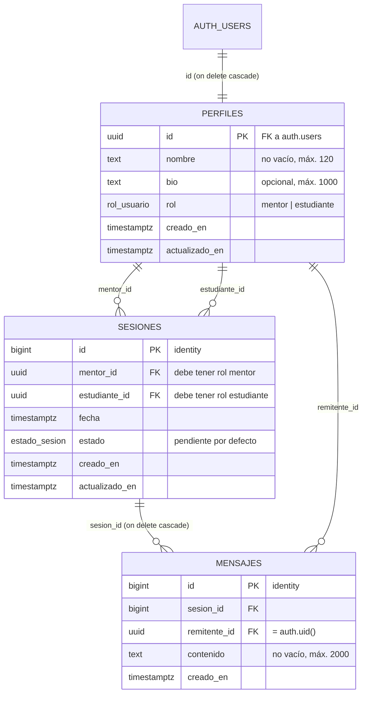

# 1. Esquema de datos y políticas RLS

MentorLink guarda tres cosas: quién es cada usuario (`perfiles`), qué mentorías se acordaron
(`sesiones`) y qué se dijeron (`mensajes`). El navegador habla directo con la base de datos a
través de la API de Supabase usando la clave pública, así que **la autorización vive en la base de
datos**: privilegios por tabla y columna, políticas RLS por fila y triggers para las reglas de
negocio.

- Fuente de verdad: [`supabase/migrations/20261027004403_inicializar_esquema.sql`](../supabase/migrations/20261027004403_inicializar_esquema.sql) (331 líneas), creado con `supabase migration new inicializar_esquema`.
- La sección [1.8](#18-script-sql-completo) es una copia exacta de ese archivo, sincronizada por
  [`herramientas/armar_entrega.py`](../herramientas/armar_entrega.py) (`--verificar` falla si difieren).
- Origen: generado con un asistente de IA a partir del [prompt maestro](02-prompts-ia.md), ejecutado,
  probado y corregido con un prompt de refinamiento.
- Verificado de verdad con la CLI de Supabase: `supabase db reset` aplica la migración y el seed, y
  `supabase test db` pasa las 41 pruebas pgTAP de
  [`supabase/tests/mentorlink_rls_test.sql`](../supabase/tests/mentorlink_rls_test.sql)
  ([salida](evidencia/cli/08-test-db.txt)). Además, las 25 comprobaciones de
  [`supabase/pruebas/rls.sql`](../supabase/pruebas/rls.sql) pasan en PostgreSQL 17
  ([salida completa](evidencia/salida-pruebas-rls.txt)).

## 1.1 Modelo de datos

Relaciones:

- `perfiles.id` → `auth.users.id` (1:1, `on delete cascade`): cada cuenta de Supabase Auth tiene un perfil.
- `sesiones.mentor_id` → `perfiles.id` y `sesiones.estudiante_id` → `perfiles.id` (1:N cada una):
  una sesión une a un mentor con un estudiante.
- `mensajes.sesion_id` → `sesiones.id` (1:N, `on delete cascade`): los mensajes pertenecen a una sesión.
- `mensajes.remitente_id` → `perfiles.id` (1:N): quién escribió el mensaje.

Diagrama entidad-relación (Mermaid, se dibuja en GitHub):



## 1.2 Tipos y restricciones

| Decisión | Por qué |
|---|---|
| `perfiles.id uuid primary key references auth.users(id) on delete cascade` | Relación 1:1 con la cuenta de Supabase Auth; borrar la cuenta borra el perfil (patrón oficial). |
| `rol` y `estado` como `enum` (`rol_usuario`, `estado_sesion`) | Valores cerrados validados por el tipo, no por texto libre. |
| `sesiones.id` y `mensajes.id` como `bigint generated always as identity` | Índices compactos y orden natural; la enumeración de ids no sirve de nada porque RLS filtra cada fila (prueba 21). |
| `check (mentor_id <> estudiante_id)` | Nadie se da una mentoría a sí mismo. |
| Textos con `check` de longitud y `btrim` | `nombre` y `contenido` no pueden ser vacíos ni solo espacios (prueba 11). |
| Fechas `timestamptz` | Mentores y estudiantes pueden estar en zonas horarias distintas. |
| FK a `perfiles` con `on delete cascade` | Si se borra una cuenta no quedan sesiones ni mensajes apuntando a nadie. Riesgo aceptado en [1.7](#17-riesgos-aceptados). |
| Índices en `mentor_id`, `estudiante_id`, `(sesion_id, creado_en)` y `remitente_id` | Son las columnas que usan las políticas; sin índice, cada consulta con RLS recorre la tabla. |
| `mensajes` sin `actualizado_en` | Los mensajes no se editan; la columna era ruido (quitada en el refinamiento). |

## 1.3 Privilegios (antes de RLS)

Una tabla nueva de `public` en Supabase nace con todos los privilegios concedidos a `anon` y
`authenticated`, y agregar políticas no los quita. Por eso la migración revoca todo y concede solo
lo que usa cada política:

| Tabla | `authenticated` | `anon` |
|---|---|---|
| `perfiles` | `select`; `update (nombre, bio)` | nada |
| `sesiones` | `select`; `insert (mentor_id, estudiante_id, fecha, estado)`; `update (estado, fecha)` | nada |
| `mensajes` | `select`; `insert (sesion_id, remitente_id, contenido)` | nada |

El privilegio por columna impide que un usuario cambie su propio `rol` (prueba 12) o mueva una
sesión a otros participantes. Sin `delete` en ninguna tabla: las sesiones se cancelan y los
mensajes son un historial inmutable (prueba 14). Las funciones de trigger tampoco se pueden
llamar desde la API (`revoke all on function ... from public, anon, authenticated`).

## 1.4 Políticas RLS

RLS está activado en las tres tablas. Todas las políticas son `to authenticated` y usan
`(select auth.uid())` en lugar de `auth.uid()`, para que Postgres evalúe la función una vez por
consulta y no una vez por fila (recomendación de rendimiento de Supabase).

| Política | Tabla | Operación | Regla |
|---|---|---|---|
| perfiles: ver propio, mentores y contrapartes de sesión | perfiles | SELECT | `id = auth.uid()` o `rol = 'mentor'` o existe una sesión donde el usuario y ese perfil son mentor y estudiante entre sí |
| perfiles: editar solo el propio | perfiles | UPDATE | `id = auth.uid()` en USING y WITH CHECK; el privilegio de columna limita a `nombre` y `bio` |
| sesiones: ver solo como participante | sesiones | SELECT | `auth.uid()` es `mentor_id` o `estudiante_id` |
| sesiones: solicitar como estudiante, pendiente y a futuro | sesiones | INSERT | `estudiante_id = auth.uid()`, `estado = 'pendiente'`, `fecha > now()`; el trigger exige roles correctos |
| sesiones: actualizar estado y fecha solo participantes | sesiones | UPDATE | participante en USING y WITH CHECK; el trigger `sesiones_validar_transicion` decide quién hace cada transición |
| mensajes: ver solo si participas en la sesión | mensajes | SELECT | existe la sesión `sesion_id` con `auth.uid()` como mentor o estudiante |
| mensajes: enviar como participante y remitente propio | mensajes | INSERT | `remitente_id = auth.uid()`, participa en la sesión y la sesión está `pendiente` o `confirmada` |

**Por qué los perfiles de mentores son visibles para cualquier usuario autenticado:** MentorLink es
un directorio donde el estudiante busca mentor; si solo viera su propio perfil no podría elegir a
nadie. Los perfiles de estudiantes no son públicos: solo los ve el mentor con quien comparten una
sesión (pruebas 03, 16 y 19).

## 1.5 Reglas en triggers

| Función (trigger) | Cuándo | Qué hace |
|---|---|---|
| `handle_new_user` (`on_auth_user_created`) | `after insert on auth.users` | Crea el perfil. Nombre: `nombre` de los metadatos, si no `full_name` (Google), si no la parte local del email. Rol: siempre `estudiante`; el `rol` que mande el cliente en los metadatos se ignora (prueba 01, sonda del rol). Promover a mentor lo hace `service_role`. `security definer` y `set search_path = ''`, como el patrón oficial. |
| `validar_roles_sesion` (`sesiones_validar_roles`) | `before insert or update of mentor_id, estudiante_id` | `mentor_id` debe tener rol mentor y `estudiante_id` rol estudiante (pruebas 08 y 25). |
| `validar_transicion_sesion` (`sesiones_validar_transicion`) | `before update of estado, fecha` | Máquina de estados: confirmar y completar solo el mentor; cancelar cualquiera de los dos; `completada` y `cancelada` son finales; la fecha solo cambia a futuro (pruebas 15, 17, 22 y 23). |
| `fijar_actualizado_en` | `before update` en perfiles y sesiones | Mantiene `actualizado_en`. |

**Por qué el rol del mentor se valida en un trigger y no en la política:** `service_role` (backend,
SQL del dashboard) se salta RLS, pero no los triggers. Así la regla «una sesión une a un mentor con
un estudiante» se cumple venga de donde venga el dato (prueba 25). Además la política quedaría
con una subconsulta extra a `perfiles` en cada inserción.

Máquina de estados de `sesiones`:

| Desde | Hacia | Quién |
|---|---|---|
| `pendiente` | `confirmada` | solo el mentor |
| `pendiente` | `cancelada` | mentor o estudiante |
| `confirmada` | `completada` | solo el mentor |
| `confirmada` | `cancelada` | mentor o estudiante |
| `completada`, `cancelada` | (ninguno) | estados finales |

## 1.6 Verificación

**Quién puede ser mentor.** `raw_user_meta_data` lo escribe el cliente en `signUp`
(`options.data`), así que no sirve para decidir permisos. Todo registro nace `estudiante` y la
promoción es una acción administrativa:

```sql
-- con service_role (backend) o desde el SQL Editor del Dashboard
update public.perfiles set rol = 'mentor' where id = '<uuid-del-usuario>';
```

Desde la API nadie se promueve a sí mismo: `authenticated` no tiene `UPDATE` sobre la columna
`rol` (prueba 12). La sonda que lo comprueba (un registro que pide `{"rol": "mentor"}` y nace
`estudiante`) está en la prueba 01 de `rls.sql` y en la pgTAP «sonda del rol».

### Pruebas pgTAP con `supabase test db`

[`supabase/tests/mentorlink_rls_test.sql`](../supabase/tests/mentorlink_rls_test.sql) tiene 41
pruebas pgTAP: estructura (RLS activo, grants, `(select auth.uid())`), `handle_new_user`, la sonda
del rol, la promoción por `service_role`, `anon`, estudiante, mentor, intruso, transiciones de
estado e integridad para roles privilegiados. Corrió con la CLI real contra Supabase local:
[`evidencia/cli/08-test-db.txt`](evidencia/cli/08-test-db.txt).

### Prueba con avisos (`rls.sql`)

[`supabase/pruebas/rls.sql`](../supabase/pruebas/rls.sql) simula cuatro usuarios con
`set local role authenticated` y `set local request.jwt.claims` (lo mismo que hace la API de
Supabase con cada JWT) y termina en `rollback`. Pasó 25 de 25 contra el Supabase local de la CLI
([salida](evidencia/cli/12-rls-sql-en-supabase-local.txt)) y en PostgreSQL 17.9 (Docker) con
[`pruebas-locales/ejecutar-pruebas.sh`](../pruebas-locales/ejecutar-pruebas.sh), sin la CLI
([salida](evidencia/salida-pruebas-rls.txt)).

| # | Qué se comprueba | Resultado esperado |
|---|---|---|
| 01 | `handle_new_user` con nombre, `full_name` de Google, `rol: "mentor"` y `rol: "admin"`; luego `service_role` promueve a dos mentores | todos nacen `estudiante`; la promoción pasa |
| 02 | `anon` lee perfiles o mensajes | `permission denied` |
| 03 | Estudiante lista perfiles | se ve a sí mismo y a los mentores, no a otros estudiantes |
| 04-07 | Solicitar sesión propia / a nombre de otro / en el pasado / ya confirmada | solo la primera pasa |
| 08 | Sesión con un estudiante como mentor | `check_violation` del trigger |
| 09-11 | Mensaje propio / suplantando remitente / vacío | solo el primero pasa |
| 12-14 | Cambiar el propio rol, editar perfil ajeno, editar o borrar mensajes, borrar sesiones | todo rechazado |
| 15 | El estudiante confirma su propia sesión | rechazado por el trigger |
| 16-18 | La mentora ve su sesión y a su estudiante, confirma y responde | pasa |
| 19-21 | Estudiante ajena lee, modifica o escribe en la sesión (aun conociendo el id) | 0 filas o rechazado |
| 22-24 | Cancelar, reabrir una cancelada, escribir en una cancelada | solo cancelar pasa |
| 25 | `service_role` crea una sesión entre dos estudiantes | rechazado por el trigger |

La primera versión que dio la IA falló en la prueba 15
([salida de esa corrida](evidencia/prueba-1-respuesta-sin-refinar.txt)); eso motivó el
refinamiento descrito en [2. Prompts de IA](02-prompts-ia.md).

## 1.7 Riesgos aceptados

- **Cascadas:** borrar una cuenta borra sus sesiones y los mensajes de ambos participantes. Si el
  historial debe sobrevivir, se cambia a borrado lógico.
- **Reprogramar sin reconfirmar:** cualquiera de los dos puede mover la fecha de una sesión
  confirmada y sigue confirmada.
- **Sesiones vencidas:** nada pasa a `completada` sola; haría falta un job (por ejemplo `pg_cron`).
- **Directorio de mentores:** toda columna nueva de `perfiles` queda visible para los mentores;
  una columna sensible iría en otra tabla.

## 1.8 Script SQL completo

<!-- INCLUIR: ../supabase/migrations/20261027004403_inicializar_esquema.sql -->
````sql
-- supabase/migrations/20261027004403_inicializar_esquema.sql
-- MentorLink: esquema inicial (perfiles, sesiones, mensajes) con RLS y privilegios explícitos.

-- =====================================================================
-- 1. TIPOS
-- =====================================================================
create type public.rol_usuario as enum ('mentor', 'estudiante');
create type public.estado_sesion as enum ('pendiente', 'confirmada', 'completada', 'cancelada');

-- =====================================================================
-- 2. TABLAS
-- =====================================================================

-- perfiles.id: uuid porque es 1:1 con auth.users; on delete cascade: si se borra la cuenta, se borra el perfil.
create table public.perfiles (
  id             uuid primary key references auth.users (id) on delete cascade,
  nombre         text not null
                 check (char_length(btrim(nombre)) > 0 and char_length(nombre) <= 120),
  bio            text
                 check (bio is null or char_length(bio) <= 1000),
  rol            public.rol_usuario not null default 'estudiante',
  creado_en      timestamptz not null default now(),
  actualizado_en timestamptz not null default now()
);

create table public.sesiones (
  -- id: bigint identity; índices compactos y la enumeración la bloquea RLS, no la opacidad del id.
  id             bigint generated always as identity primary key,
  -- mentor_id: on delete cascade; borrar la cuenta del mentor elimina sus sesiones (no hay perfil al que apuntar).
  mentor_id      uuid not null references public.perfiles (id) on delete cascade,
  -- estudiante_id: on delete cascade; mismo criterio que mentor_id (las columnas son not null).
  estudiante_id  uuid not null references public.perfiles (id) on delete cascade,
  fecha          timestamptz not null,
  estado         public.estado_sesion not null default 'pendiente',
  creado_en      timestamptz not null default now(),
  actualizado_en timestamptz not null default now(),
  constraint sesiones_participantes_distintos check (mentor_id <> estudiante_id)
);

-- mensajes: sin actualizado_en; el historial es inmutable y no hay UPDATE.
create table public.mensajes (
  -- id: bigint identity; volumen alto, orden natural de inserción y RLS protege el acceso.
  id             bigint generated always as identity primary key,
  -- sesion_id: on delete cascade; un mensaje no tiene sentido sin su sesión.
  sesion_id      bigint not null references public.sesiones (id) on delete cascade,
  -- remitente_id: on delete cascade; el remitente es not null y su cuenta borrada arrastra sus mensajes.
  remitente_id   uuid not null references public.perfiles (id) on delete cascade,
  contenido      text not null
                 check (char_length(btrim(contenido)) > 0 and char_length(contenido) <= 2000),
  creado_en      timestamptz not null default now()
);

-- =====================================================================
-- 3. ÍNDICES (columnas FK usadas en políticas y joins)
-- =====================================================================
create index sesiones_mentor_id_idx      on public.sesiones (mentor_id);
create index sesiones_estudiante_id_idx  on public.sesiones (estudiante_id);
create index mensajes_sesion_id_idx      on public.mensajes (sesion_id, creado_en);
create index mensajes_remitente_id_idx   on public.mensajes (remitente_id);

-- =====================================================================
-- 4. FUNCIONES Y TRIGGERS
-- =====================================================================

-- 4.1 Mantener actualizado_en (solo perfiles y sesiones; mensajes no se editan)
create or replace function public.fijar_actualizado_en()
returns trigger
language plpgsql
set search_path = ''
as $$
begin
  new.actualizado_en := pg_catalog.now();
  return new;
end;
$$;

create trigger perfiles_fijar_actualizado_en
  before update on public.perfiles
  for each row execute function public.fijar_actualizado_en();

create trigger sesiones_fijar_actualizado_en
  before update on public.sesiones
  for each row execute function public.fijar_actualizado_en();

-- 4.2 Crear el perfil al registrarse (patrón oficial de Supabase)
--   El rol NO se toma de raw_user_meta_data: ese campo lo escribe el cliente en signUp
--   (options.data), así que cualquiera podría registrarse como mentor. Todo registro nace
--   'estudiante'; promover a mentor es una acción administrativa con service_role
--   (backend o SQL del Dashboard), porque authenticated no tiene UPDATE sobre perfiles.rol.
create or replace function public.handle_new_user()
returns trigger
language plpgsql
security definer
set search_path = ''
as $$
declare
  v_meta   jsonb := coalesce(new.raw_user_meta_data, '{}'::jsonb);
  v_nombre text;
begin
  v_nombre := coalesce(
    nullif(pg_catalog.btrim(v_meta ->> 'nombre'), ''),
    nullif(pg_catalog.btrim(v_meta ->> 'full_name'), ''),          -- Google OAuth
    nullif(pg_catalog.btrim(pg_catalog.split_part(new.email, '@', 1)), ''),
    'usuario'                                                        -- sin email (p. ej. teléfono)
  );
  v_nombre := pg_catalog.left(v_nombre, 120);

  insert into public.perfiles (id, nombre, rol)
  values (new.id, v_nombre, 'estudiante'::public.rol_usuario);

  return new;
end;
$$;

create trigger on_auth_user_created
  after insert on auth.users
  for each row execute function public.handle_new_user();

-- 4.3 Validar roles de los participantes de una sesión (aplica también a service_role)
create or replace function public.validar_roles_sesion()
returns trigger
language plpgsql
security definer
set search_path = ''
as $$
begin
  if not exists (
    select 1 from public.perfiles p
    where p.id = new.mentor_id and p.rol = 'mentor'::public.rol_usuario
  ) then
    raise exception 'mentor_id (%) no corresponde a un perfil con rol mentor', new.mentor_id
      using errcode = 'check_violation';
  end if;

  if not exists (
    select 1 from public.perfiles p
    where p.id = new.estudiante_id and p.rol = 'estudiante'::public.rol_usuario
  ) then
    raise exception 'estudiante_id (%) no corresponde a un perfil con rol estudiante', new.estudiante_id
      using errcode = 'check_violation';
  end if;

  return new;
end;
$$;

create trigger sesiones_validar_roles
  before insert or update of mentor_id, estudiante_id on public.sesiones
  for each row execute function public.validar_roles_sesion();

-- 4.4 Máquina de estados de sesiones (aplica también a service_role).
--   pendiente  -> confirmada : solo el mentor
--   pendiente  -> cancelada  : cualquiera de los dos participantes
--   confirmada -> completada : solo el mentor
--   confirmada -> cancelada  : cualquiera de los dos
--   completada y cancelada   : finales, no cambian
--   fecha: solo cambia en pendiente o confirmada, y siempre a futuro.
--   Con auth.uid() null (service_role, SQL del dashboard) se validan las transiciones, no el actor.
create or replace function public.validar_transicion_sesion()
returns trigger
language plpgsql
security definer
set search_path = ''
as $$
declare
  v_uid uuid := auth.uid();
begin
  -- Estados finales: ni estado ni fecha pueden cambiar.
  if old.estado in ('completada'::public.estado_sesion, 'cancelada'::public.estado_sesion)
     and (new.estado is distinct from old.estado or new.fecha is distinct from old.fecha) then
    raise exception 'la sesión % está en estado final (%) y no puede cambiar', old.id, old.estado
      using errcode = 'check_violation';
  end if;

  -- Transiciones de estado.
  if new.estado is distinct from old.estado then
    if old.estado = 'pendiente'::public.estado_sesion
       and new.estado = 'confirmada'::public.estado_sesion then
      if v_uid is not null and v_uid <> old.mentor_id then
        raise exception 'solo el mentor puede confirmar la sesión %', old.id
          using errcode = 'check_violation';
      end if;

    elsif old.estado = 'confirmada'::public.estado_sesion
          and new.estado = 'completada'::public.estado_sesion then
      if v_uid is not null and v_uid <> old.mentor_id then
        raise exception 'solo el mentor puede completar la sesión %', old.id
          using errcode = 'check_violation';
      end if;

    elsif old.estado in ('pendiente'::public.estado_sesion, 'confirmada'::public.estado_sesion)
          and new.estado = 'cancelada'::public.estado_sesion then
      -- Cualquiera de los dos participantes; la política de UPDATE ya exige participar.
      null;

    else
      raise exception 'transición de estado no permitida en la sesión %: % -> %',
        old.id, old.estado, new.estado
        using errcode = 'check_violation';
    end if;
  end if;

  -- Cambio de fecha: solo en pendiente o confirmada y a futuro.
  if new.fecha is distinct from old.fecha then
    if old.estado not in ('pendiente'::public.estado_sesion, 'confirmada'::public.estado_sesion) then
      raise exception 'la fecha de la sesión % solo cambia en pendiente o confirmada', old.id
        using errcode = 'check_violation';
    end if;
    if new.fecha <= pg_catalog.now() then
      raise exception 'la nueva fecha de la sesión % debe ser futura', old.id
        using errcode = 'check_violation';
    end if;
  end if;

  return new;
end;
$$;

create trigger sesiones_validar_transicion
  before update of estado, fecha on public.sesiones
  for each row execute function public.validar_transicion_sesion();

-- Las funciones de trigger no deben poder invocarse desde la API.
revoke all on function public.fijar_actualizado_en()       from public, anon, authenticated;
revoke all on function public.handle_new_user()            from public, anon, authenticated;
revoke all on function public.validar_roles_sesion()       from public, anon, authenticated;
revoke all on function public.validar_transicion_sesion()  from public, anon, authenticated;

-- =====================================================================
-- 5. PRIVILEGIOS
-- =====================================================================
revoke all on table public.perfiles from public, anon, authenticated;
revoke all on table public.sesiones from public, anon, authenticated;
revoke all on table public.mensajes from public, anon, authenticated;

-- perfiles: lectura y edición de nombre y bio (rol no editable).
grant select                 on table public.perfiles to authenticated;
grant update (nombre, bio)   on table public.perfiles to authenticated;

-- sesiones: lectura, alta (sin id ni auditoría) y cambio de estado y fecha.
grant select                                            on table public.sesiones to authenticated;
grant insert (mentor_id, estudiante_id, fecha, estado)  on table public.sesiones to authenticated;
grant update (estado, fecha)                            on table public.sesiones to authenticated;

-- mensajes: lectura y alta; sin update ni delete.
grant select                                      on table public.mensajes to authenticated;
grant insert (sesion_id, remitente_id, contenido) on table public.mensajes to authenticated;

-- =====================================================================
-- 6. RLS Y POLÍTICAS
-- =====================================================================
alter table public.perfiles enable row level security;
alter table public.sesiones enable row level security;
alter table public.mensajes enable row level security;

-- ---------- perfiles ----------
create policy "perfiles: ver propio, mentores y contrapartes de sesión"
  on public.perfiles
  for select
  to authenticated
  using (
    id = (select auth.uid())
    or rol = 'mentor'::public.rol_usuario
    or exists (
      select 1
      from public.sesiones s
      where (s.mentor_id = (select auth.uid()) and s.estudiante_id = perfiles.id)
         or (s.estudiante_id = (select auth.uid()) and s.mentor_id = perfiles.id)
    )
  );

create policy "perfiles: editar solo el propio"
  on public.perfiles
  for update
  to authenticated
  using (id = (select auth.uid()))
  with check (id = (select auth.uid()));

-- ---------- sesiones ----------
create policy "sesiones: ver solo como participante"
  on public.sesiones
  for select
  to authenticated
  using ((select auth.uid()) in (mentor_id, estudiante_id));

create policy "sesiones: solicitar como estudiante, pendiente y a futuro"
  on public.sesiones
  for insert
  to authenticated
  with check (
    estudiante_id = (select auth.uid())
    and estado = 'pendiente'::public.estado_sesion
    and fecha > now()
  );

-- Quién puede hacer cada transición lo decide el trigger sesiones_validar_transicion.
create policy "sesiones: actualizar estado y fecha solo participantes"
  on public.sesiones
  for update
  to authenticated
  using ((select auth.uid()) in (mentor_id, estudiante_id))
  with check ((select auth.uid()) in (mentor_id, estudiante_id));

-- ---------- mensajes ----------
create policy "mensajes: ver solo si participas en la sesión"
  on public.mensajes
  for select
  to authenticated
  using (
    exists (
      select 1
      from public.sesiones s
      where s.id = mensajes.sesion_id
        and (select auth.uid()) in (s.mentor_id, s.estudiante_id)
    )
  );

create policy "mensajes: enviar como participante y remitente propio"
  on public.mensajes
  for insert
  to authenticated
  with check (
    remitente_id = (select auth.uid())
    and exists (
      select 1
      from public.sesiones s
      where s.id = mensajes.sesion_id
        and (select auth.uid()) in (s.mentor_id, s.estudiante_id)
        and s.estado in ('pendiente'::public.estado_sesion, 'confirmada'::public.estado_sesion)
    )
  );
````
<!-- /INCLUIR -->

## Fuentes

- Row Level Security: https://supabase.com/docs/guides/database/postgres/row-level-security
- Rendimiento de RLS (`(select auth.uid())`, índices): https://supabase.com/docs/guides/troubleshooting/rls-performance-and-best-practices-Z5Jjwv
- Perfiles y trigger `handle_new_user`: https://supabase.com/docs/guides/auth/managing-user-data
- Migraciones: https://supabase.com/docs/guides/deployment/database-migrations
